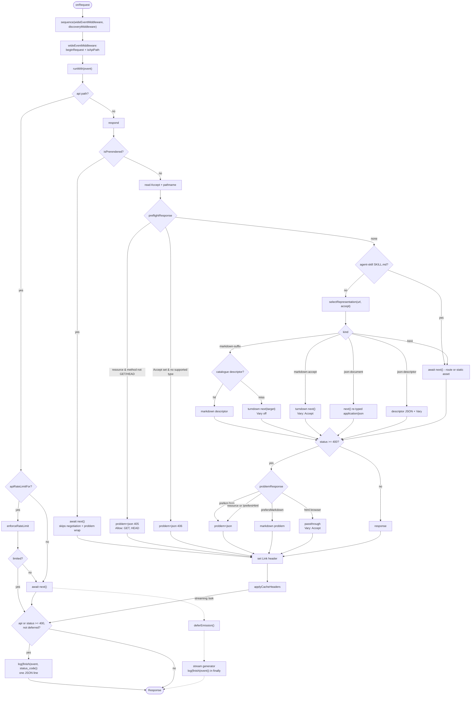

# Middleware

`src/middleware.ts` is a thin shim that chains two handlers with `sequence`.
The outermost, `wideEventMiddleware` in `src/lib/wide-event-middleware.ts`,
opens one wide event per request and closes it after the response (see
[logging.md](logging.md) and [ADR 016](adr/016-wide-event-logging.md)). The
inner `discoveryMiddleware` is a shim over `src/features/discovery/` (see
[ADR 008](adr/008-single-discovery-module.md)): it advertises the discovery
surface with response headers, negotiates the representation of a page or
discovery resource, converts errors into RFC 9457 problems, meters API
paths, and applies the cache policy from `cache.ts` (see
[ADR 024](adr/024-discovery-responses-cache-at-the-cdn.md)). The vocabulary
below matches [GLOSSARY.md](GLOSSARY.md).

## Request flow

## Also in this topic

- [Middleware branches](middleware-branches.md) — every guard in the flow and its result.
- [Middleware notes](middleware-notes.md) — cross-cutting constraints on the flow.
